# Jol

[](https://github.com/zhandos717/jol/actions/workflows/ci.yml)
[](LICENSE)

**Jol** (каз. *жол* — дорога) — сервис такси и доставки для Казахстана, построенный как набор событийно-ориентированных микросервисов: такси, грузовое, межгород и попутчики, курьерская доставка посылок и еды из ресторанов, коэффициент спроса, взаимные рейтинги, события в реальном времени.

TypeScript · Node.js 22 · NATS JetStream · PostgreSQL 17 · OSRM · nginx · Docker Compose

## Архитектура

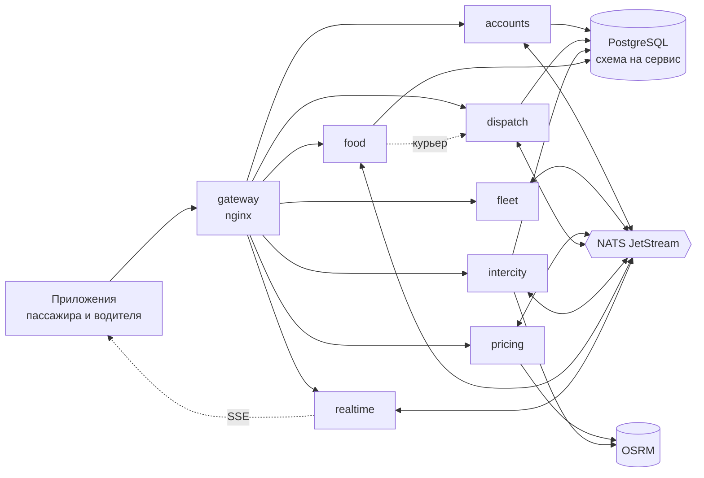

| Сервис | Отвечает за | Хранилище |
|---|---|---|
| [`accounts`](services/accounts) | профили, рейтинги, заработок | PostgreSQL + inbox/outbox |
| [`fleet`](services/fleet) | водители на линии, координаты, поиск ближайших | память |
| [`pricing`](services/pricing) | цена, коэффициент спроса, фиксация цены | NATS KV с TTL |
| [`dispatch`](services/dispatch) | заказы такси и курьеров, раздача, заказы на время, код вручения | PostgreSQL + outbox |
| [`intercity`](services/intercity) | рейсы с попутчиками и брони | PostgreSQL + outbox |
| [`food`](services/food) | рестораны, меню, заказ еды, оркестрация курьера | PostgreSQL + inbox/outbox |
| [`realtime`](services/realtime) | события в браузер через SSE | — |

**Ключевые решения:**
- **Transactional outbox и идемпотентные потребители:** изменение и событие фиксируются атомарно, повторная доставка не даёт двойного эффекта.
- **Compare-and-set на переходах статуса заказа** и частичные уникальные индексы: два водителя не примут один заказ, у пассажира не будет двух активных заказов.
- **Идемпотентное создание заказа** по `Idempotency-Key`: повторные нажатия и сетевые ретраи возвращают тот же заказ.
- **Оркестрация доставки еды с запасным планом:** `food` бронирует курьера у `dispatch` идемпотентным RPC; если велокурьер не найден, сам перезаказывает машину.
- **Код вручения:** 4 цифры видит только заказчик, курьер без кода не закроет доставку, перебор ограничен.
- **Своя схема и роль PostgreSQL на сервис:** чужие таблицы недоступны физически, а не по договорённости.
- **Горячие геоданные в памяти, деньги в БД:** выбор хранилища по времени жизни данных.

Подробно — [docs/architecture](docs/architecture/README.md), решения с альтернативами — [ADR](docs/architecture/adr/README.md), события — [каталог](docs/architecture/events.md), API — [OpenAPI](docs/api/openapi.yaml).

## Скриншоты

**Пассажир**

| Тарифы | Грузовое | Межгород | Поиск машины |
|---|---|---|---|
| 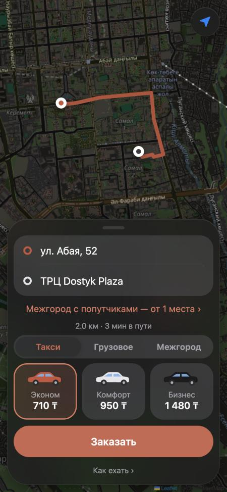 | 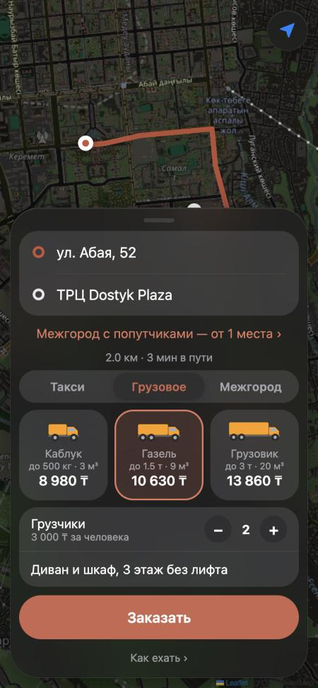 | 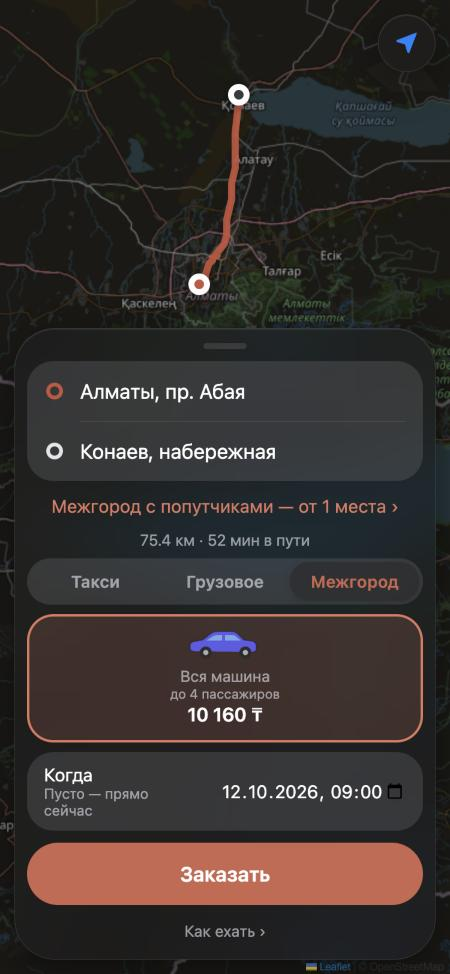 | 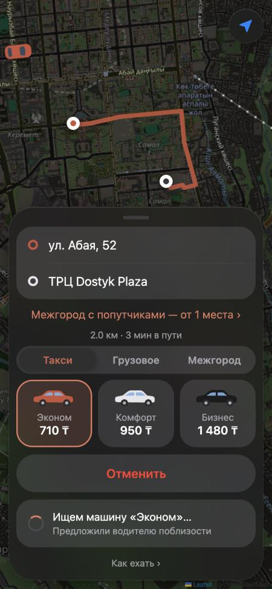 |
| **Водитель едет** | **В пути** | **Оценка водителя** | **Попутчики** |
| 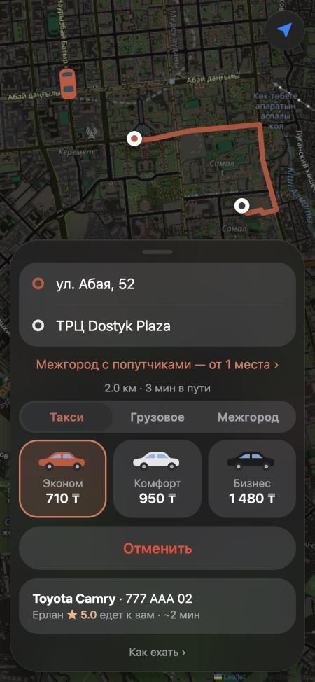 | 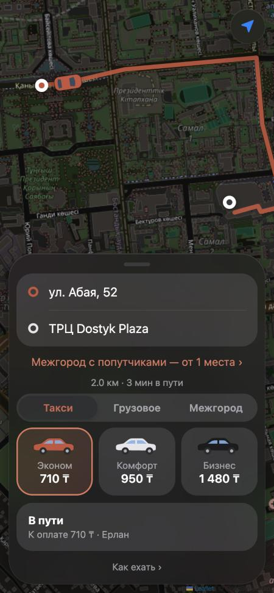 | 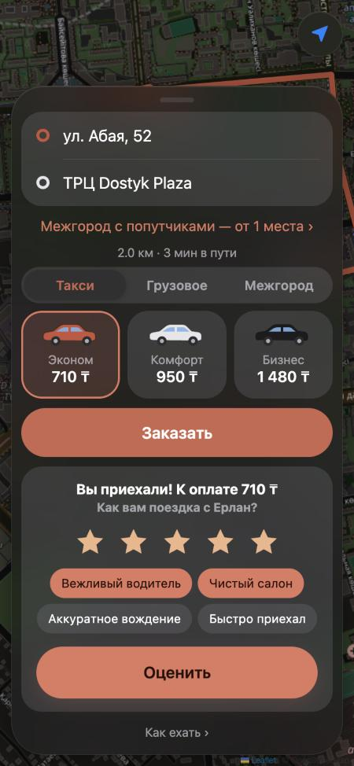 | 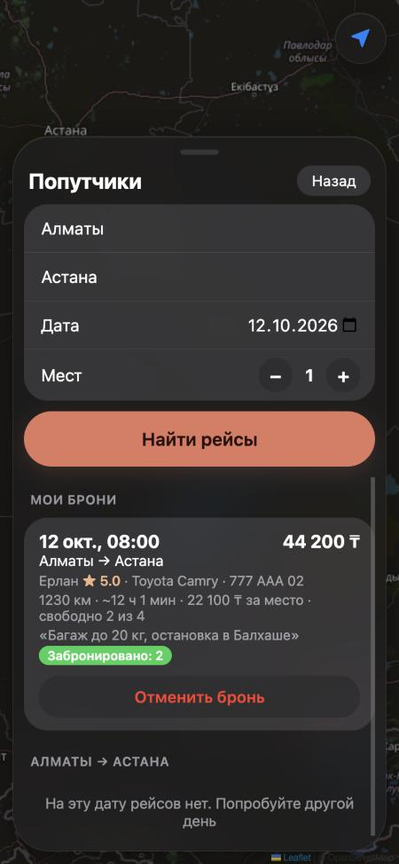 |

**Еда**

| Рестораны | Меню | Оформление | Отслеживание | Панель ресторана |
|---|---|---|---|---|
| 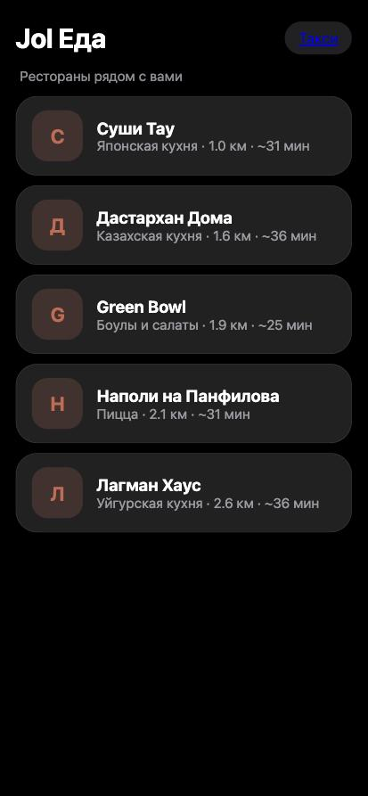 | 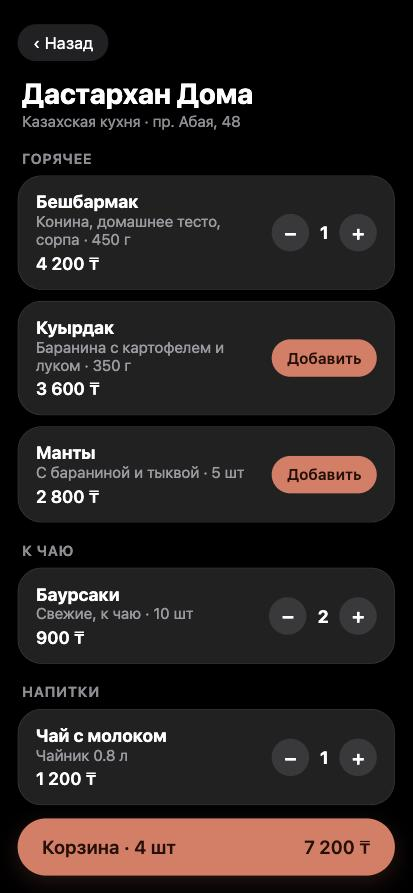 | 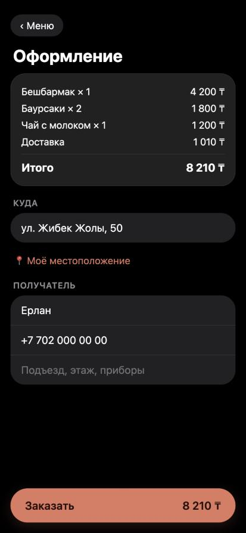 | 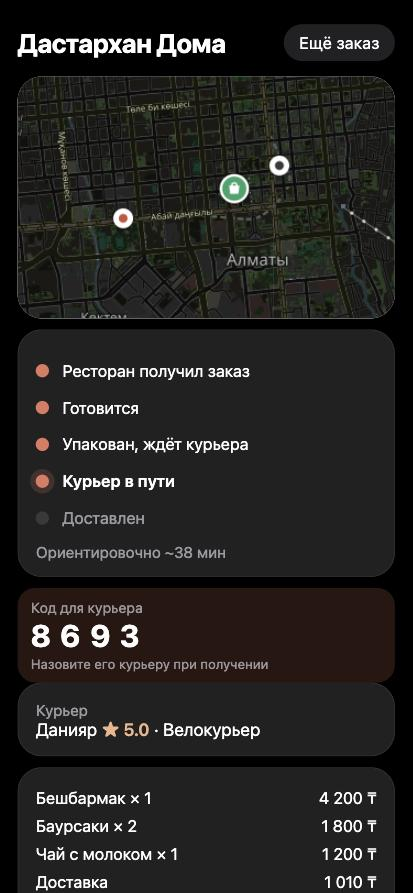 | 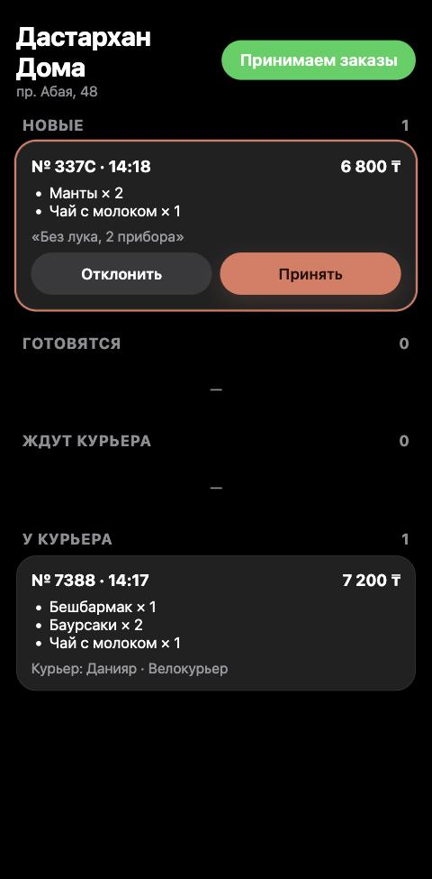 |

**Водитель**

| Профиль | На линии | Новый заказ | Едет к клиенту |
|---|---|---|---|
| 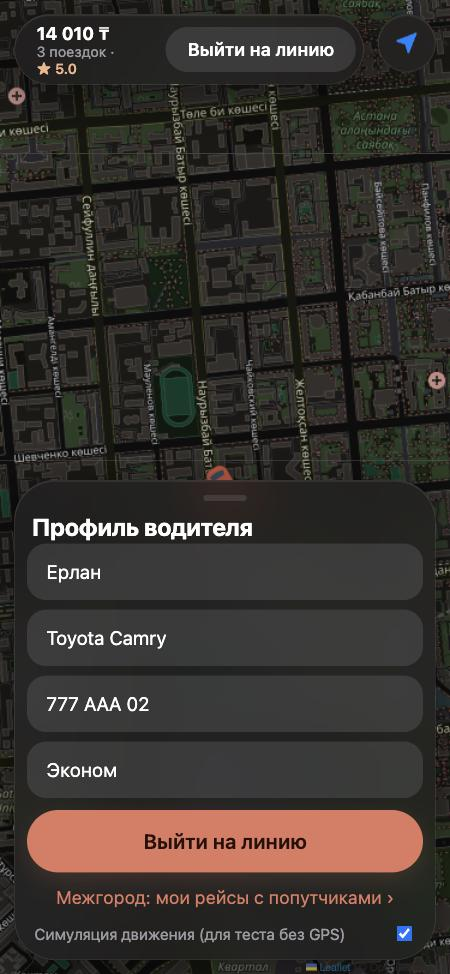 | 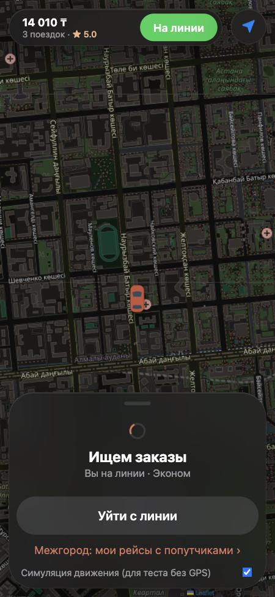 | 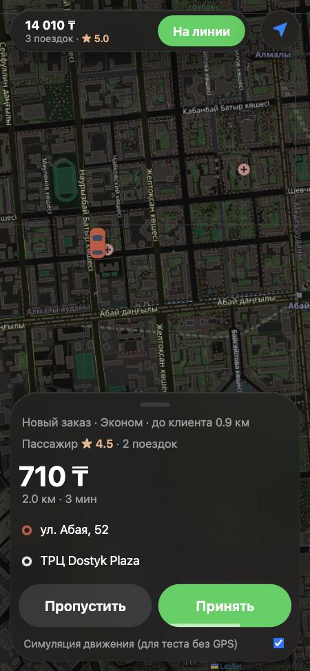 | 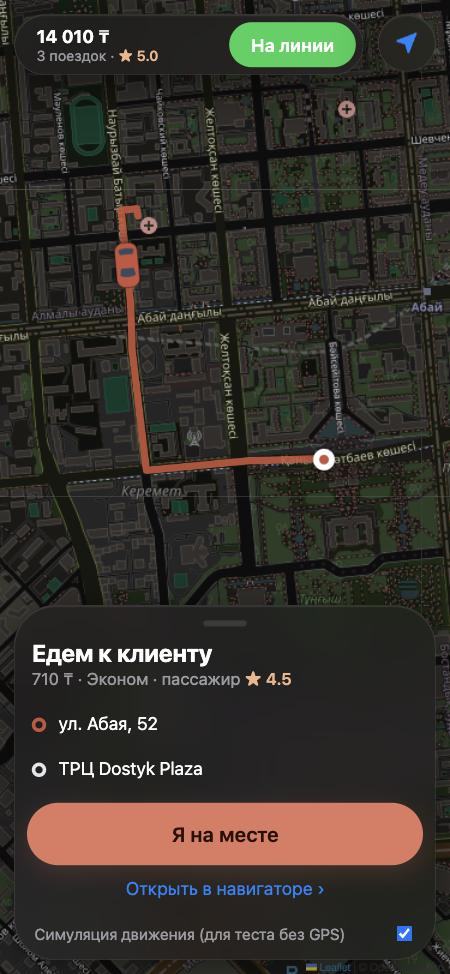 |
| **Поездка и зоны спроса** | **Оценка пассажира** | **Мои рейсы** | |
| 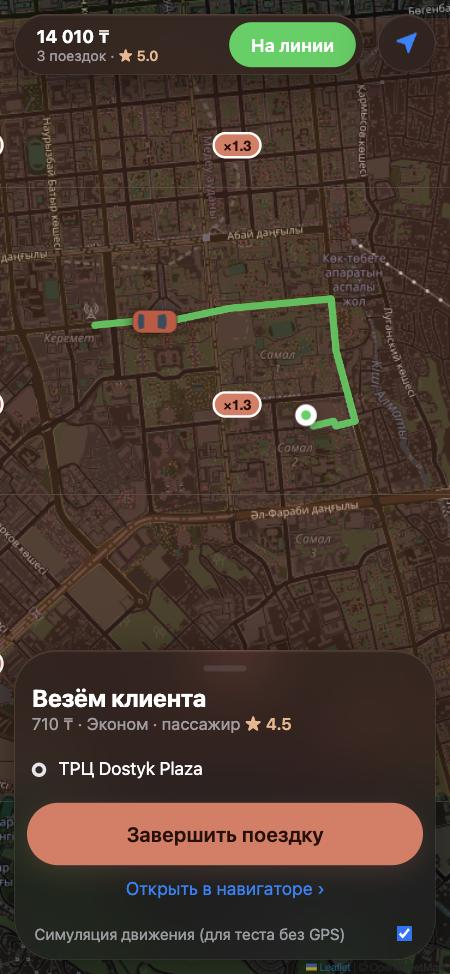 | 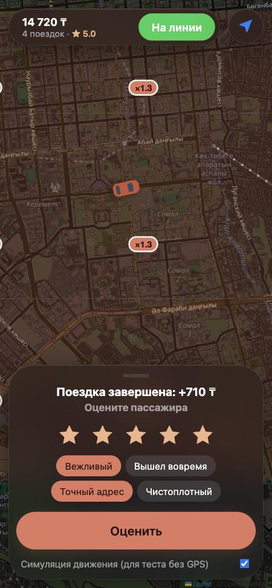 | 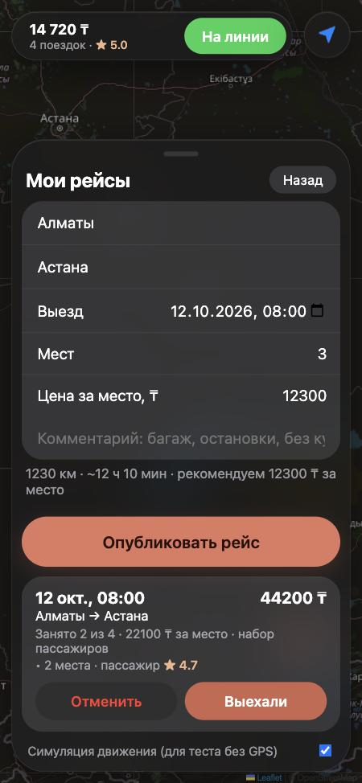 | |

## Быстрый старт

Нужны Docker с Compose, `make` и Node.js 22 (для тестов).

```bash
make up
```

При первом запуске скачивается карта Казахстана с Geofabrik (224 МБ) и готовится для маршрутов, на 1 vCPU это 2–5 минут. Потом всё поднимается за секунды.

| Приложение | Адрес |
|---|---|
| Пассажир (такси, грузовое, межгород, доставка посылок) | http://localhost:8080/ |
| Водитель и курьер | http://localhost:8080/driver.html |
| Еда из ресторанов | http://localhost:8080/food.html |
| Панель ресторана | http://localhost:8080/restaurant.html |

Чтобы проверить заказ на одном компьютере, откройте приложения в разных вкладках. У водителя включите «Симуляцию движения»: машина поедет по маршруту сама. Для доставки еды выберите в профиле водителя курьерский тариф и откройте панель ресторана «Дастархан Дома».

## Разработка

```
make help        все команды
make typecheck   проверка типов монорепозитория (tsc -b)
make test        юнит-тесты (vitest)
make e2e         сквозной тест против запущенного стека
make bench       нагрузочный тест: make bench DRIVERS=5000
make logs S=dispatch     логи сервиса
make rebuild S=pricing   пересобрать один сервис
make health      /readyz всех сервисов
make psql        консоль PostgreSQL
make backup      дамп базы
```

```
apps/web/                 приложения пассажира, водителя, еды и ресторана (статические, отдаёт nginx)
packages/contracts/       схемы событий, RPC и API (zod) — единственное, что сервисы знают друг о друге
packages/kit/             общая инфраструктура: запуск, NATS, PostgreSQL, outbox/inbox, HTTP, OSRM
services/<name>/          src/ (код и *.test.ts), migrations/ (SQL с комментариями к колонкам)
infra/                    nginx, PostgreSQL (роли и схемы), подготовка карты OSRM
docs/                     архитектура, ADR, каталог событий, OpenAPI, скриншоты
scripts/                  e2e.mjs, bench.js
```

**Тесты.**
- 29 юнит-тестов на доменную логику: цена и коэффициент, автоматы статусов заказа и заказа еды, реестр водителей, правила бронирования, корзина, выбор курьера, рейтинг, формат SSE.
- 19 сквозных проверок через шлюз: гонки, идемпотентность, итоговая согласованность, код вручения, полная цепочка доставки еды через четыре сервиса.

CI в GitHub Actions на каждый push и PR: проверка типов, тесты, сборка образов всех семи сервисов, сквозной тест на поднятом стеке.

## Производительность

`make bench` на 1 vCPU / 4 ГБ (Docker Desktop, Apple Silicon), 2000 водителей онлайн. Генератор нагрузки работает на том же ядре, что и сервисы, поэтому это нижняя оценка.

| Запрос | req/s | p99 |
|---|---|---|
| Координаты водителя (`fleet`) | ~5 300 | 51 мс |
| Машины рядом (`fleet`) | ~3 000 | 37 мс |
| Карта спроса (`pricing`) | ~1 900 | 158 мс |
| Расчёт цены с маршрутом OSRM (`pricing`) | ~750 | 109 мс |

Как растёт каждый сервис и где его потолок — в [разделе о масштабировании](docs/architecture/README.md#7-масштабирование).

## Требования к серверу

| Этап | CPU | RAM | Диск |
|---|---|---|---|
| Демо и показы | 2 vCPU | 4 ГБ | 30 ГБ SSD |
| Пилот в одном городе | 4 vCPU | 8 ГБ | 60 ГБ SSD |
| Несколько городов | отдельные узлы под PostgreSQL, OSRM и сервисы; реплики `realtime` и `pricing` | | |

Больше всего памяти занимает OSRM: граф дорог Казахстана, около 600 МБ. Каждый сервис на Node.js — 60–120 МБ, NATS — около 20 МБ.

## Чего нет и почему

- **Аутентификация.** Пользователь определяется по id из браузера. Следующий шаг — вход по SMS и JWT на шлюзе ([раздел 8 архитектуры](docs/architecture/README.md#9-безопасность-что-сознательно-не-сделано)).
- **Свой геокодер и тайлы карты.** Поиск адресов и картинки карты идут в публичный OpenStreetMap, у которого есть лимиты ([ADR-0008](docs/architecture/adr/0008-self-hosted-routing.md)).
- **Трассировка.** Есть сквозной `X-Request-Id` в логах, OpenTelemetry — следующий шаг.

## Настройки

| Переменная | По умолчанию | Назначение |
|---|---|---|
| `POSTGRES_PASSWORD` | `jol_local_dev` | пароль администратора PostgreSQL |
| `SERVICE_DB_PASSWORD` | `jol_local_dev` | пароль ролей сервисов |
| `LOG_LEVEL` | `info` | уровень логов сервисов |

На сервере задайте их в `.env` (шаблон — `.env.example`).

## Лицензия

Код — [MIT](LICENSE). Карта и данные OpenStreetMap — © участники OpenStreetMap, лицензия ODbL.
