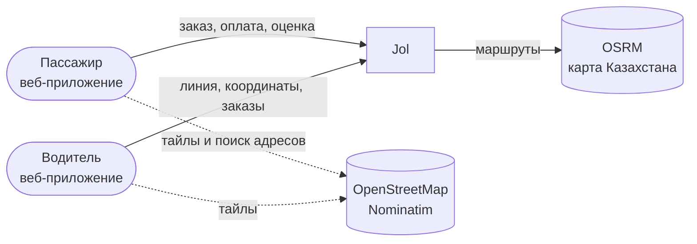
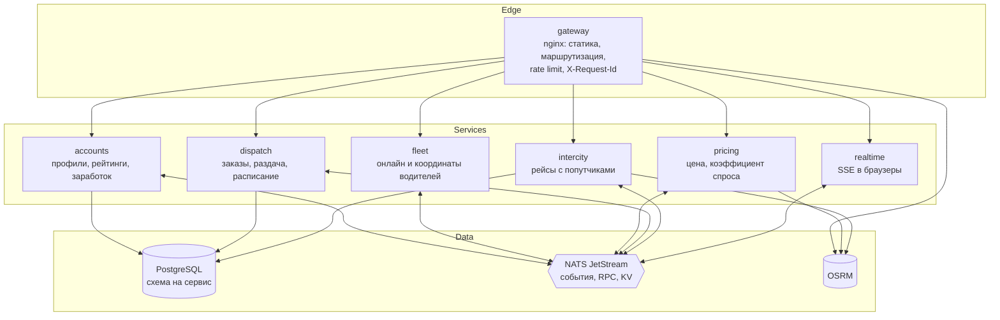
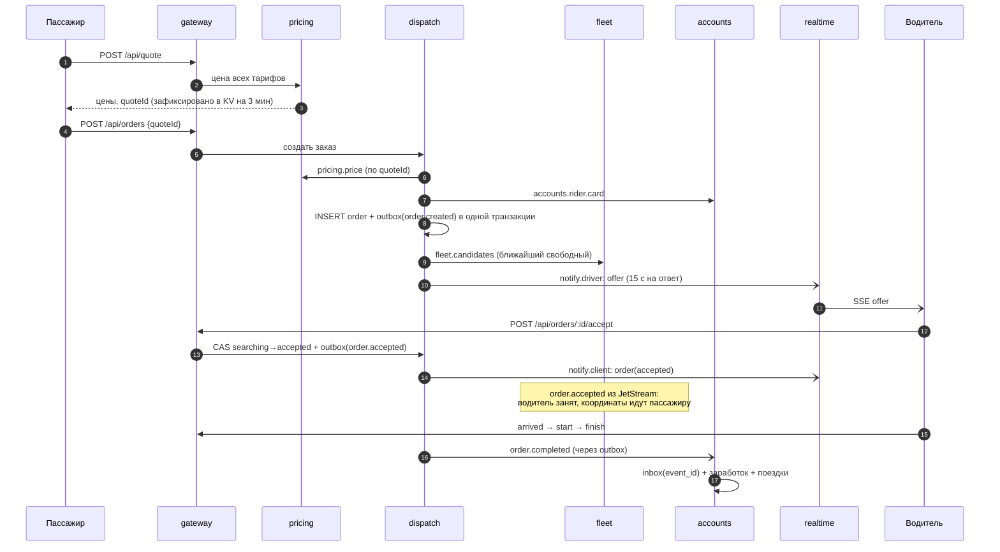

# Архитектура Jol

Документ для инженеров, которые будут развивать систему: как она устроена, почему именно так и где её пределы. Решения с обоснованием и альтернативами — в [ADR](adr/).

## 1. Контекст (C4, уровень 1)

## 2. Контейнеры (C4, уровень 2)

| Сервис | Ответственность | Данные | Почему отдельный |
|---|---|---|---|
| `accounts` | профили водителей и пассажиров, рейтинги, заработок | PostgreSQL `accounts` | меняется редко, нужен строгий учёт денег и оценок |
| `fleet` | онлайн-присутствие, координаты, поиск ближайших | память | горячий путь: тысячи обновлений в секунду, данные живут секунды |
| `pricing` | расчёт цены, коэффициент спроса, фиксация цены | NATS KV (TTL 3 мин) | бизнес-правила цены меняются чаще всего, без БД |
| `dispatch` | жизненный цикл заказа, раздача водителям, заказы на время | PostgreSQL `dispatch` | ядро домена, транзакционные переходы статусов |
| `intercity` | рейсы с попутчиками, брони мест | PostgreSQL `intercity` | другая модель (рейс и места), другой ритм |
| `realtime` | доставка событий в браузер через SSE | — | держит тысячи долгих соединений, масштабируется отдельно |

## 3. Взаимодействие

Три вида связей, каждый для своей задачи:

| Тип | Транспорт | Гарантия | Пример |
|---|---|---|---|
| Доменные события | JetStream, стрим `JOL` | at-least-once, durable-потребители, дедупликация по id | `jol.dispatch.order.completed` → `accounts` начисляет заработок |
| Синхронные запросы | NATS request/reply | таймаут 3 с, схема запроса и ответа проверяется с обеих сторон | `dispatch` → `fleet.candidates` |
| Уведомления клиентам | core NATS `notify.<role>.<id>` | best effort | `dispatch` → `realtime` → браузер пассажира |

Все контракты в одном месте — пакет [`@jol/contracts`](../../packages/contracts/src). Каталог событий — [events.md](events.md).

## 4. Жизненный цикл заказа

Если водитель отказался или молчит 15 секунд, заказ уходит следующему ближайшему. Через 90 секунд без согласия — статус `no_drivers`.

## 5. Надёжность

- **Нет потерянных событий.** Изменение состояния и событие пишутся в одной транзакции (transactional outbox, [ADR-0004](adr/0004-outbox-and-idempotent-consumers.md)). Relay публикует с `Nats-Msg-Id = event.id`, JetStream отбрасывает дубли в окне 2 минуты.
- **Нет двойной обработки.** Потребители с состоянием (`accounts`) записывают id события в `inbox` в той же транзакции, что и эффект.
- **Нет гонок за заказ.** Переходы статусов — compare-and-set: `UPDATE … WHERE status = ANY(<разрешённые источники>)`. Плюс частичные уникальные индексы: один активный заказ на пассажира и на водителя.
- **Деградация вместо падения.** `accounts` недоступен → заказ создаётся с карточкой пассажира по умолчанию. `fleet` недоступен для `pricing` → используется последнее известное предложение машин.
- **Корректная остановка.** SIGTERM: HTTP перестаёт принимать запросы, outbox дописывает очередь, NATS-соединение drain'ится, пул БД закрывается.
- **Самовосстановление памяти.** `fleet` после рестарта забирает активные назначения у `dispatch`; водители возвращаются сами, потому что приложение повторно выходит на линию, если сервер их не знает.

## 6. Масштабирование

| Сервис | Как растёт | Ограничение сейчас |
|---|---|---|
| `realtime`, `pricing`, `accounts`, `intercity` | горизонтально, без изменений: queue group в NATS, состояние в БД или KV | — |
| `fleet` | шардирование по городам или H3-ячейкам; или состояние в Redis/NATS KV | один экземпляр, состояние в памяти ([ADR-0006](adr/0006-fleet-presence-in-memory.md)) |
| `dispatch` | партиционирование по городу, лидер на партицию через NATS KV-лок | один активный экземпляр, офферы в памяти ([ADR-0007](adr/0007-single-active-dispatcher.md)) |
| PostgreSQL | реплики на чтение для истории; при росте — вынос схем в отдельные кластеры без изменения кода | один кластер |

Замер нагрузки монолитной версии на 1 vCPU: ~10 000 обновлений координат в секунду, ~800 расчётов цены в секунду. Сервисная версия держит те же пути, теперь их можно масштабировать независимо.

## 7. Наблюдаемость

- Логи — структурированный JSON (pino) с полем `service`; gateway пишет JSON-лог доступа.
- `X-Request-Id` создаётся на шлюзе, передаётся в сервисы и попадает в каждую строку лога запроса.
- У каждого сервиса `/healthz` (жив ли процесс) и `/readyz` (доступны ли БД и NATS) — для оркестратора.
- Мониторинг NATS — `:8222` (стримы, отставание потребителей).

Следующий шаг — OpenTelemetry: трассировка через HTTP и заголовки NATS, метрики в Prometheus.

## 8. Безопасность: что сознательно не сделано

Это демонстрационный проект, и это главный пробел перед продакшеном: **нет аутентификации.** Пассажир и водитель определяются по id, который генерирует браузер. Сервер проверяет владение заказом по этому id, но подделать его может любой. План: вход по SMS → JWT на шлюзе → `sub` из токена вместо id в теле запроса.
